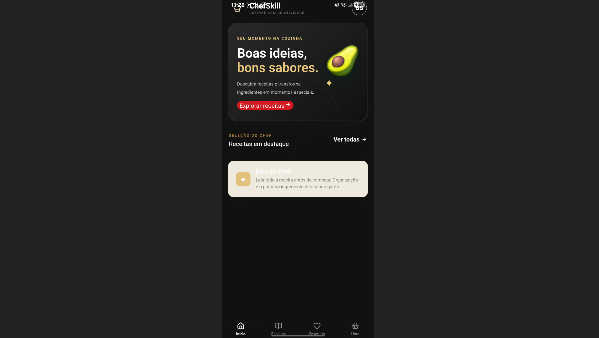
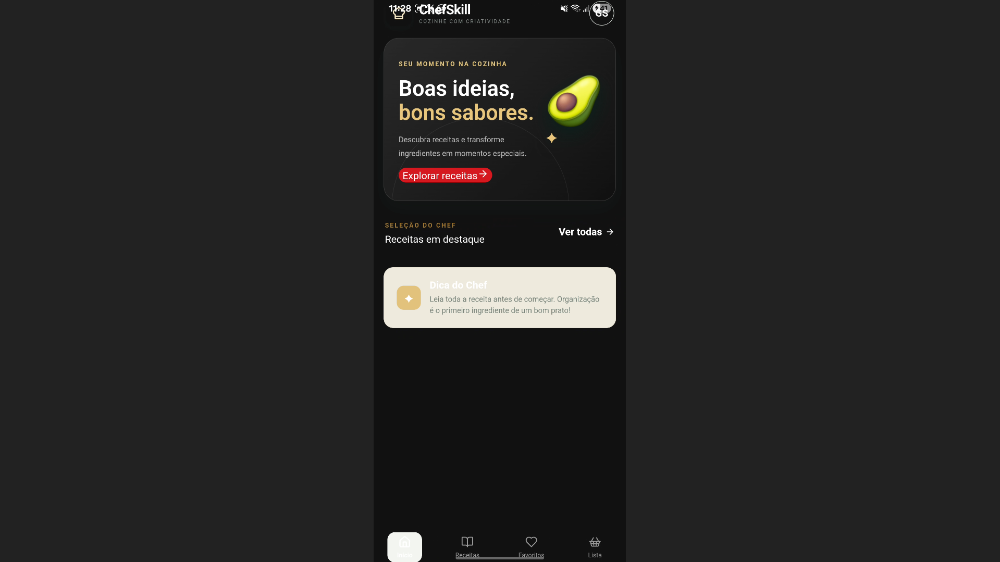
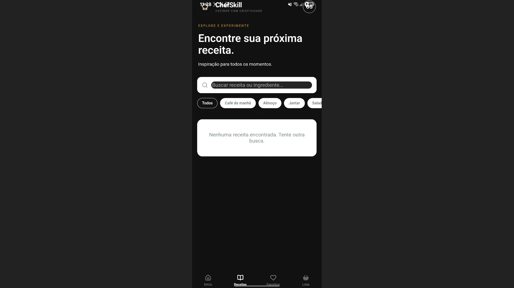
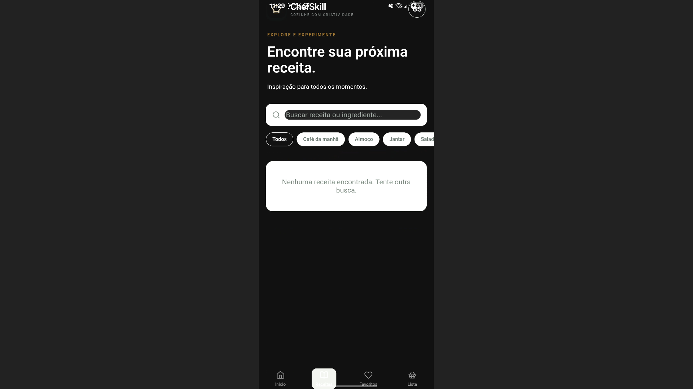
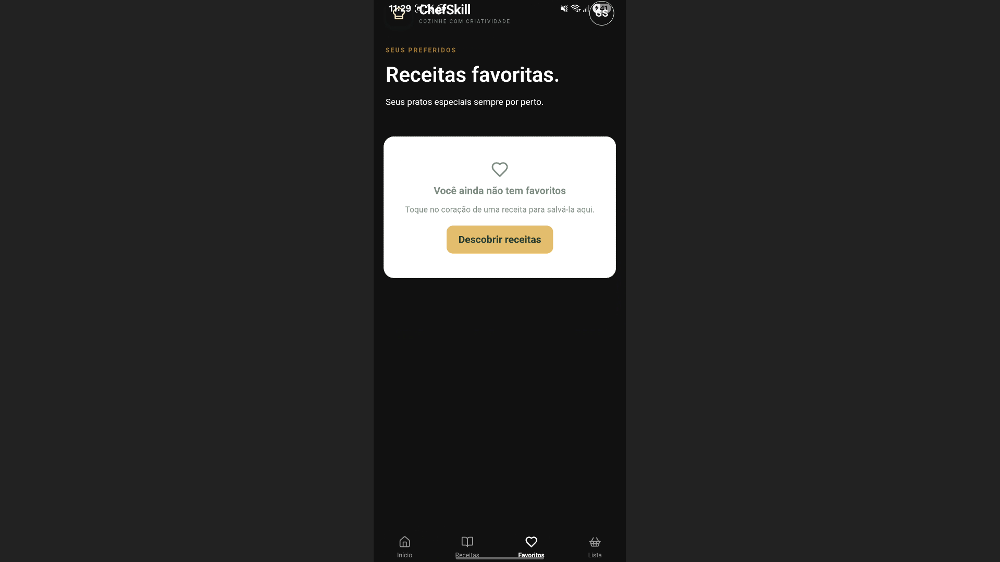
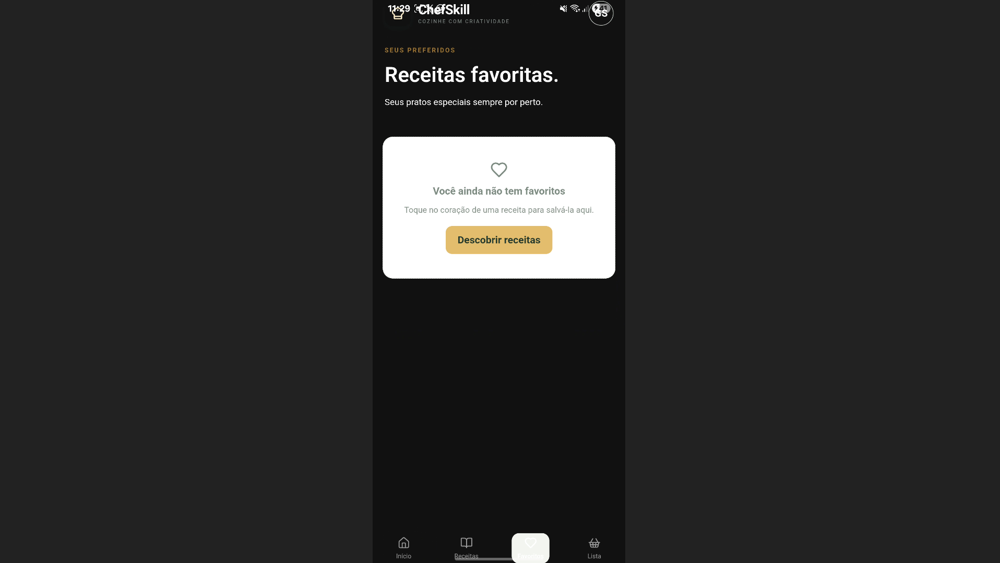
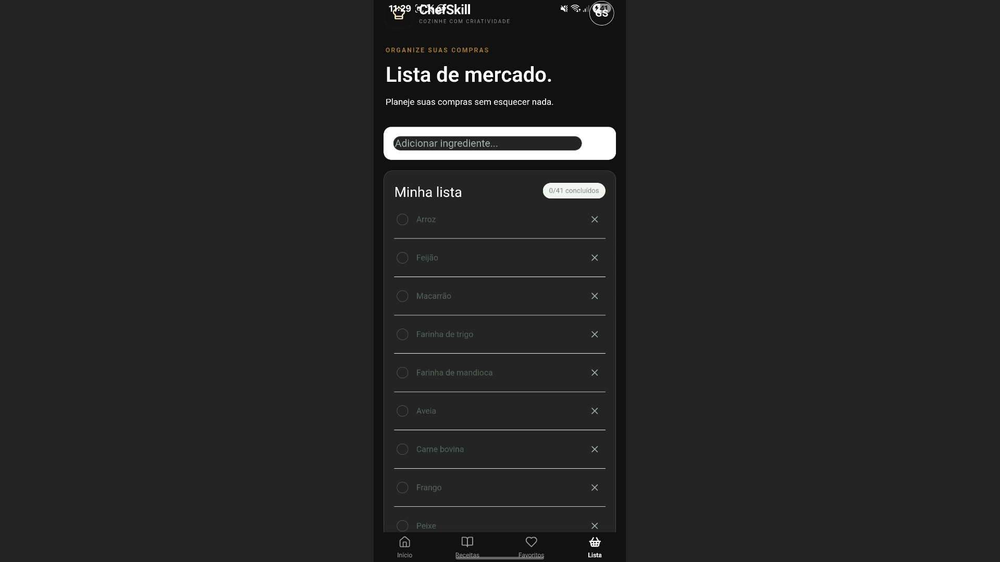
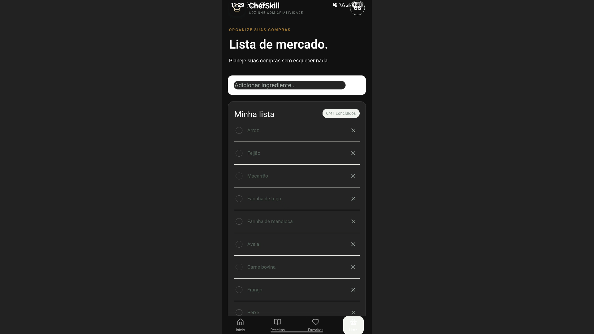

# ChefSkill #08

Aplicativo mobile de receitas culinárias passo a passo e lista de mercado, desenvolvido com React, Vite e Capacitor.

## Funcionalidades
- Catálogo de receitas com busca e categorias.
- Modo de preparo dividido em etapas.
- Ingredientes com marcação de itens já separados.
- Favoritos.
- Lista de mercado com inclusão, remoção e marcação de itens.
- Interface responsiva para celular e desktop.

## Tecnologias
React • Vite • JavaScript • CSS • Capacitor • Lucide React

## Executar localmente
```bash
npm install
npm run dev
```

## Gerar a versão web
```bash
npm run build
```

## Preparar Android
É necessário ter o Android SDK e o ambiente Android configurados.
```bash
npx cap add android
npx cap sync android
npx cap open android
```

Para gerar o APK debug localmente, com o ambiente Android configurado:
```bash
cd android
./gradlew assembleDebug
```
No Windows PowerShell, use `.\gradlew.bat assembleDebug`.

## Identidade visual
- Verde principal: `#183B32`
- Verde secundário: `#285B4B`
- Creme: `#F6F5EF`
- Dourado: `#D7A84B`

Adicione os arquivos de identidade visual em `assets/`:
- `assets/icon.png` — 1024 × 1024 px, fundo opaco, sem cantos arredondados desenhados.
- `assets/splash.png` — arte com logotipo centralizado e margem de segurança.

Depois instale/execute o gerador:
```bash
npm install @capacitor/assets --save-dev
npx capacitor-assets generate --android
npx cap sync android
```

## Build automático no GitHub
O workflow `.github/workflows/android-build.yml` compila o APK em cada push para `main` ou `master`. No GitHub, abra **Actions**, selecione a execução concluída e baixe o artefato **meu-aplicativo-apk**.

> Antes do primeiro build na nuvem, gere a pasta nativa Android com `npx cap add android` e envie a pasta `android/` ao repositório. O workflow não cria o projeto Android do zero.

## Imagens do aplicativo
Adicione capturas de tela em `docs/screenshots/` e insira-as aqui:
```md








```

## Autor
Aluno 08 — Projeto acadêmico ChefSkill.
